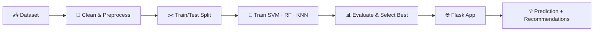

<div align="center">

# 🩺 Hybrid Machine Learning System for Diabetes Risk Prediction
### and Smart Health Recommendations

*Hybrid ML + rule-based system: diabetes risk estimation with general, safety-conscious health guidance.*


[Overview](#-overview) · [Features](#-features) · [Workflow](#-workflow) · [Quick Start](#-quick-start) · [Structure](#-project-structure) · [Results](#-model-performance) · [Roadmap](#-roadmap)

</div>

---

> [!WARNING]
> **Educational tool only.** This project estimates diabetes *likelihood* from health indicators. It does **not** diagnose diabetes, prescribe medication, or replace laboratory tests or a healthcare professional.

## 📌 Overview

Users enter health indicators (glucose level, blood pressure, BMI, age, and other dataset features). A trained classifier estimates the likelihood of diabetes, and a rule-based module returns simple, general health recommendations.

**Course project:** Bachelor of Data Science (BSDS), Superior University Lahore (Gold Campus).

## ✨ Features

| | Feature | Description |
|---|---|---|
| 🧹 | **Data preprocessing** | Missing-value checks, feature distribution analysis, cleaning |
| 🤖 | **Model comparison** | SVM, Random Forest, KNN compared on accuracy, precision, recall, F1-score |
| 🌐 | **Flask web app** | Simple form for health inputs with instant prediction |
| 💡 | **Smart recommendations** | Rule-based general guidance from inputs and model output |
| ⚠️ | **Safety messaging** | Clear limitations and a prompt to seek professional assessment |

## 🔄 Workflow



## 🛠️ Tech Stack

- **Language:** Python
- **ML:** scikit-learn (SVM, Random Forest, KNN)
- **Data:** pandas, NumPy
- **Visualization:** Matplotlib / Seaborn
- **Web:** Flask, HTML, CSS

## 🚀 Quick Start

```bash
# 1. Clone
git clone https://github.com/<your-username>/hybrid-diabetes-risk-prediction.git
cd hybrid-diabetes-risk-prediction

# 2. Virtual environment
python -m venv venv
source venv/bin/activate        # Windows: venv\Scripts\activate

# 3. Install dependencies
pip install -r requirements.txt

# 4. Train models (saves best model to models/)
python src/train.py

# 5. Run the app
python app.py
```

Open **http://127.0.0.1:5000** in your browser.

## 📂 Project Structure

```text
hybrid-diabetes-risk-prediction/
├── data/                  # Dataset (raw + processed)
├── notebooks/             # EDA and experiments
├── src/
│   ├── preprocess.py      # Cleaning and feature preparation
│   ├── train.py           # Train and compare models
│   ├── evaluate.py        # Metrics and plots
│   └── recommend.py       # Rule-based recommendations
├── models/                # Saved best model
├── templates/             # HTML templates
├── static/                # CSS and assets
├── app.py                 # Flask entry point
├── requirements.txt
└── README.md
```

## 📊 Model Performance

Fill in after training and evaluation.

| Model | Accuracy | Precision | Recall | F1-score |
|---|:---:|:---:|:---:|:---:|
| SVM | – | – | – | – |
| Random Forest | – | – | – | – |
| KNN | – | – | – | – |

**Selected model:** _TBD_

## 🎯 Scope

| ✅ In scope | ❌ Out of scope |
|---|---|
| Diabetes-risk prediction from dataset features | Diagnosing diabetes |
| Preprocessing, training, evaluation | Prescribing medication |
| Web interface and prediction display | Replacing lab tests or doctors |
| Rule-based general recommendations | Treatment decisions |

## 🗺️ Roadmap

- [x] Project proposal
- [ ] Dataset exploration and preprocessing
- [ ] Train and compare SVM, Random Forest, KNN
- [ ] Select best model and save it
- [ ] Build Flask interface
- [ ] Rule-based recommendation module
- [ ] Evaluation plots and final report
- [ ] Future: additional datasets, more conditions, Urdu-language support, personalized recommendations

## 📚 References

1. [CDC: Diabetes resources](https://www.cdc.gov/diabetes/)
2. [WHO: Diabetes fact sheet](https://www.who.int/news-room/fact-sheets/detail/diabetes)
3. [scikit-learn User Guide](https://scikit-learn.org/stable/user_guide.html)
4. [UCI Machine Learning Repository](https://archive.ics.uci.edu/)

## 👥 Authors

Add team members and supervisor here.

## 📄 License

Released under the [MIT License](LICENSE).

---

<div align="center">

**⭐ Star this repo if you found it useful.**

*Predictions are estimates. Always consult a qualified healthcare professional.*

</div>
